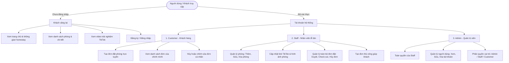
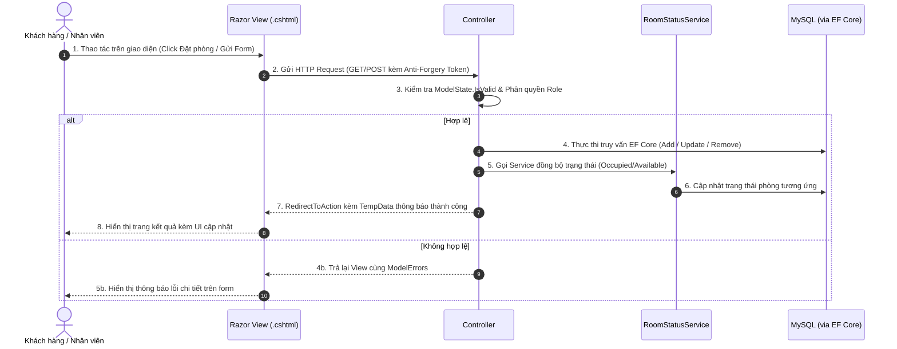
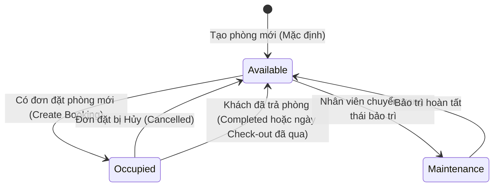
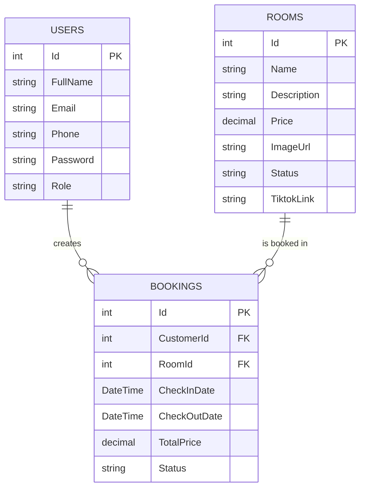
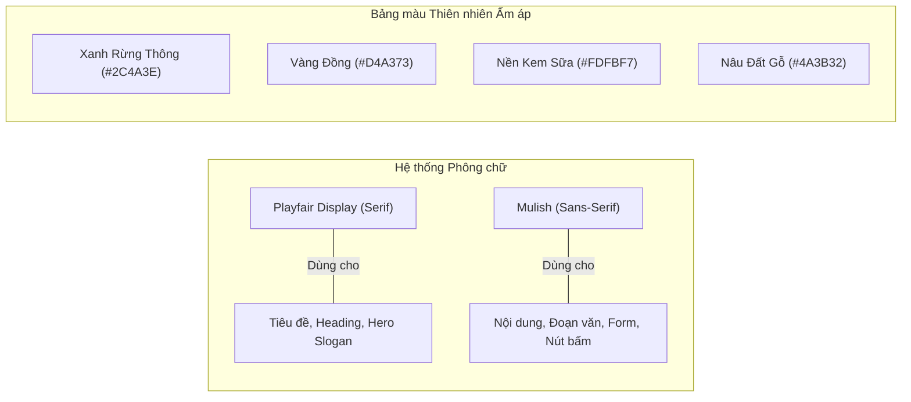

# BÁO CÁO ĐỒ ÁN & HƯỚNG DẪN VẬN HÀNH
# HỆ THỐNG QUẢN LÝ & ĐẶT PHÒNG FINN HOMESTAY

---

## MỤC LỤC
1. [I. GIỚI THIỆU TỔNG QUAN HỆ THỐNG](#i-giới-thiệu-tổng-quan-hệ-thống)
   - [1.1. Giới thiệu dự án](#11-giới-thiệu-dự-án)
   - [1.2. Mục tiêu đề tài](#12-mục-tiêu-đề-tài)
   - [1.3. Ngăn xếp công nghệ (Technology Stack)](#13-ngăn-xếp-công-nghệ-technology-stack)
   - [1.4. Phân quyền và các vai trò người dùng (User Roles)](#14-phân-quyền-và-các-vai-trò-người-dùng-user-roles)
2. [II. HƯỚNG DẪN CÀI ĐẶT & KHỞI CHẠY (SETUP GUIDE)](#ii-hướng-dẫn-cài-đặt--khởi-chạy-setup-guide)
   - [2.1. Yêu cầu môi trường & Công cụ](#21-yêu-cầu-môi-trường--công-cụ)
   - [2.2. Cấu hình chuỗi kết nối Database (Connection String)](#22-cấu-hình-chuỗi-kết-nối-database-connection-string)
   - [2.3. Khởi tạo Cơ sở dữ liệu bằng Entity Framework Core Migration](#23-khởi-tạo-cơ-sở-dữ-liệu-bằng-entity-framework-core-migration)
   - [2.4. Biên dịch và Khởi chạy ứng dụng](#24-biên-dịch-và-khởi-chạy-ứng-dụng)
   - [2.5. Danh sách tài khoản mẫu dùng cho kiểm thử (Seed Accounts)](#25-danh-sách-tài-khoản-mẫu-dùng-cho-kiểm-thử-seed-accounts)
3. [III. KIẾN TRÚC HỆ THỐNG & LUỒNG HOẠT ĐỘNG (CRUD WORKFLOWS)](#iii-kiến-trúc-hệ-thống--luồng-hoạt-động-crud-workflows)
   - [3.1. Mô hình kiến trúc MVC (Model - View - Controller)](#31-mô-hình-kiến-trúc-mvc-model---view---controller)
   - [3.2. Cơ chế Xác thực & Phân quyền (Cookie Authentication & Authorization)](#32-cơ-chế-xác-thực--phân-quyền-cookie-authentication--authorization)
   - [3.3. Phân tích Luồng CRUD Quản lý Phòng (Room Management)](#33-phân-tích-luồng-crud-quản-lý-phòng-room-management)
   - [3.4. Phân tích Luồng CRUD Quản lý Đơn đặt phòng (Booking Management)](#34-phân-tích-luồng-crud-quản-lý-đơn-đặt-phòng-booking-management)
   - [3.5. Phân tích Luồng CRUD Quản lý Tài khoản (User Management)](#35-phân-tích-luồng-crud-quản-lý-tài-khoản-user-management)
4. [IV. THIẾT KẾ GIAO DIỆN & TRẢI NGHIỆM NGƯỜI DÙNG (UI/UX DESIGN)](#iv-thiết-kế-giao-diện--trải-nghiệm-người-dùng-uiux-design)
   - [4.1. Định hướng phong cách thiết kế (Modern Cozy Homestay)](#41-định-hướng-phong-cách-thiết-kế-modern-cozy-homestay)
   - [4.2. Giải pháp kỹ thuật: Custom CSS Override thay vì Bootstrap thuần](#42-giải-pháp-kỹ-thuật-custom-css-override-thay-vì-bootstrap-thuần)
   - [4.3. Nghệ thuật Typography & Phối màu](#43-nghệ-thuật-typography--phối-màu)
   - [4.4. Micro-interactions & Trải nghiệm thực tế](#44-micro-interactions--trải-nghiệm-thực-tế)
5. [V. KẾT LUẬN & ĐÁNH GIÁ](#v-kết-luận--đánh-giá)

---

# I. GIỚI THIỆU TỔNG QUAN HỆ THỐNG

### 1.1. Giới thiệu dự án
- **Tên hệ thống:** Website Giới thiệu & Đặt phòng trực tuyến Finn Homestay.
- **Bối cảnh:** Finn Homestay là một mô hình nghỉ dưỡng ấm cúng, thư thái tọa lạc tại khu vực biển đảo (địa chỉ thực tế: *36 đường ven biển, Lại Sơn, An Giang*). Dự án được xây dựng dưới dạng Đồ án môn học / Niên luận Công nghệ Thông tin nhằm giải quyết bài toán chuyển đổi số: giới thiệu không gian homestay trực quan, số hóa quy trình quản lý phòng và tiếp nhận đơn đặt phòng trực tuyến từ khách hàng.

### 1.2. Mục tiêu đề tài
1. Xây dựng một cổng thông tin trực tuyến có tính thẩm mỹ cao, tạo cảm xúc ấm cúng, thân thiện (*Cozy & Peaceful*) ngay khi người dùng truy cập.
2. Cung cấp quy trình đặt phòng khép kín: Khách hàng tìm phòng $\rightarrow$ Xem chi tiết / Xem video TikTok thực tế $\rightarrow$ Tạo đơn đặt phòng $\rightarrow$ Nhân viên tiếp nhận xét duyệt.
3. Hỗ trợ Staff/Admin quản lý danh mục phòng, theo dõi lịch đặt, phòng ngừa trùng lịch (*Overlapping Prevention*), tự động hóa việc tính giá và cập nhật trạng thái phòng.
4. Quản lý phân quyền chặt chẽ giữa 3 cấp độ: Khách hàng (Customer), Nhân viên lễ tân (Staff), Quản trị viên (Admin).

### 1.3. Ngăn xếp công nghệ (Technology Stack)

| Thành phần | Công nghệ / Thư viện sử dụng | Vai trò & Đặc điểm |
| :--- | :--- | :--- |
| **Nền tảng chính** | `.NET 10.0` (C# 13/14) | Framework backend hiện đại, hiệu năng cao, hỗ trợ Dependency Injection mạnh mẽ |
| **Kiến trúc web** | `ASP.NET Core MVC` | Mô hình phân lớp Controller - View - Model tường minh, dễ bảo trì |
| **ORM & CSDL** | `Entity Framework Core 9.0.2` & `Pomelo.EntityFrameworkCore.MySql` | Code-First ORM, tự động sinh Migration và đồng bộ schema |
| **Cơ sở dữ liệu** | `MySQL 8.x` | Hệ quản trị cơ sở dữ liệu quan hệ mạnh mẽ, chuẩn mực |
| **Xác thực** | `Cookie Authentication` | Cơ chế xác thực thông qua HTTP Cookie và ClaimsPrincipal (không phụ thuộc Identity cồng kềnh) |
| **Giao diện (Frontend)** | `Razor Views`, `HTML5`, `CSS3`, `JavaScript (Vanilla ES6)` | Server-side rendering tốc độ cao, hỗ trợ dynamic DOM scripting |
| **Thư viện UI** | `Bootstrap 5.3`, `FontAwesome 6.5` | Hệ thống lưới responsive và kho biểu tượng trực quan |
| **Phông chữ** | Google Fonts: `Playfair Display` + `Mulish` | Định hình phong cách thiết kế sang trọng, ấm cúng |

### 1.4. Phân quyền và các vai trò người dùng (User Roles)

Hệ thống thiết kế theo cơ chế **RBAC (Role-Based Access Control)** với 3 vai trò phân cấp rõ ràng:



---

# II. HƯỚNG DẪN CÀI ĐẶT & KHỞI CHẠY (SETUP GUIDE)

### 2.1. Yêu cầu môi trường & Công cụ
Để chạy được project trên máy tính cá nhân hoặc phòng máy thực hành, bạn cần chuẩn bị:
1. **.NET SDK:** Phiên bản `.NET 10.0 SDK` (hoặc tương thích mới nhất của Microsoft).
   - Kiểm tra bằng lệnh: `dotnet --version`
2. **Cơ sở dữ liệu:** `MySQL Server 8.0+` (hoặc thông qua XAMPP / WampServer / Docker).
   - Đảm bảo MySQL Service đang chạy trên cổng mặc định `3306`.
3. **Công cụ phát triển (IDE khuyến nghị):**
   - Visual Studio 2026 / Visual Studio Code / JetBrains Rider.
   - EF Core Tools CLI: Kiểm tra bằng `dotnet ef --version`. Nếu chưa có, cài đặt bằng:
     ```bash
     dotnet tool install --global dotnet-ef
     ```

### 2.2. Cấu hình chuỗi kết nối Database (Connection String)
Mở file [appsettings.Development.json](file:///d:/code/FinnHomestay/appsettings.Development.json) hoặc [appsettings.json](file:///d:/code/FinnHomestay/appsettings.json) tại thư mục gốc, điều chỉnh lại mật khẩu MySQL của máy bạn:

```json
{
  "ConnectionStrings": {
    "DefaultConnection": "Server=localhost;Port=3306;Database=FinnHomestayDb;Uid=root;Pwd=12345;"
  }
}
```
> **Lưu ý:**
> - `Server=localhost;Port=3306`: Địa chỉ máy chủ MySQL cục bộ.
> - `Database=FinnHomestayDb`: Tên CSDL hệ thống sẽ tự động tạo.
> - `Uid=root`: Tên tài khoản quản trị MySQL.
> - `Pwd=...`: Đổi `12345` thành mật khẩu root MySQL trên máy tính của bạn (nếu dùng XAMPP mặc định mật khẩu là rỗng: `Pwd=;`).

### 2.3. Khởi tạo Cơ sở dữ liệu bằng Entity Framework Core Migration
Hệ thống sử dụng cơ chế **Code-First**. Bạn không cần phải tạo bảng thủ công bằng file `.sql`. Chỉ cần mở Terminal tại thư mục gốc của project (`d:\code\FinnHomestay`) và chạy lệnh sau:

```bash
dotnet ef database update
```

**Quá trình thực thi:**
- Entity Framework Core sẽ kết nối tới MySQL, tự động tạo cơ sở dữ liệu `FinnHomestayDb` (nếu chưa có).
- Chạy lần lượt các Migration:
  1. `20261116115930_InitialCreate`: Tạo bảng `Users`, `Rooms`, `Bookings`.
  2. `20261119011618_AddTiktokLinkToRoom`: Thêm cột `TiktokLink` vào bảng `Rooms`.
- Tạo bảng quản lý lịch sử `__EFMigrationsHistory`.

### 2.4. Biên dịch và Khởi chạy ứng dụng
Chạy lệnh sau tại cửa sổ dòng lệnh:

```bash
dotnet run
```
Sau khi server khởi động thành công, console sẽ hiển thị thông báo:
```text
info: Microsoft.Hosting.Lifetime[14]
      Now listening on: http://localhost:5038
info: Microsoft.Hosting.Lifetime[0]
      Application started. Press Ctrl+C to shut down.
```
Mở trình duyệt bất kỳ (Chrome, Edge) và truy cập đường dẫn: **`http://localhost:5038`**

### 2.5. Danh sách tài khoản mẫu dùng cho kiểm thử (Seed Accounts)
Hệ thống đã tích hợp sẵn cơ chế **Tự động Seed dữ liệu (Auto-seeding)**. Khi hệ thống khởi chạy lần đầu hoặc bảng dữ liệu trống, các tài khoản và phòng mẫu sau sẽ được khởi tạo tự động:

| Vai trò (Role) | Email đăng nhập | Mật khẩu | Quyền hạn nổi bật |
| :--- | :--- | :--- | :--- |
| **Admin** | `admin@finnhomestay.com` | `123456` | Toàn quyền hệ thống: Quản lý phòng, đơn đặt, và phân quyền tài khoản |
| **Staff** | `staff@finnhomestay.com` | `123456` | Quản lý phòng (CRUD, sửa video TikTok) & Duyệt/Check-out đơn đặt |
| **Customer** | `customer@finnhomestay.com` | `123456` | Xem phòng, đặt phòng, theo dõi và hủy đơn đặt của chính mình |

---

# III. KIẾN TRÚC HỆ THỐNG & LUỒNG HOẠT ĐỘNG (CRUD WORKFLOWS)

### 3.1. Mô hình kiến trúc MVC (Model - View - Controller)

Hệ thống tuân thủ chặt chẽ nguyên lý **Separation of Concerns (Phân tách mối quan tâm)** của ASP.NET Core MVC:

```
FinnHomestay/
├── Controllers/         # Tiếp nhận HTTP Request, xử lý điều hướng & gọi Service/Db
│   ├── AuthController.cs
│   ├── HomeController.cs
│   ├── RoomController.cs
│   ├── BookingController.cs
│   └── UserController.cs
├── Models/              # Thực thể cơ sở dữ liệu và các ViewModels chứa dữ liệu validation
│   ├── Room.cs
│   ├── Booking.cs
│   ├── User.cs
│   ├── AuthViewModels.cs
│   └── UserViewModels.cs
├── Views/               # Giao diện hiển thị Razor (.cshtml)
│   ├── Home/
│   ├── Room/
│   ├── Booking/
│   ├── User/
│   └── Shared/
├── Services/            # Tầng nghiệp vụ độc lập (Business Logic Layer)
│   ├── IRoomStatusService.cs
│   └── RoomStatusService.cs
├── Data/                # DbContext quản lý kết nối CSDL và cấu hình Fluent API
│   └── AppDbContext.cs
└── wwwroot/             # Tài nguyên tĩnh: CSS tùy biến, JavaScript, hình ảnh homestay
```



---

### 3.2. Cơ chế Xác thực & Phân quyền (Cookie Authentication & Authorization)
Dự án không sử dụng thư viện ASP.NET Core Identity mặc định nhằm giữ cho cấu trúc CSDL gọn gàng, phù hợp đồ án đại học. Thay vào đó, hệ thống sử dụng **Cookie Authentication thuần túy**:

1. **Đăng nhập (`AuthController.Login`):**
   - Khi người dùng gửi Email và Mật khẩu, controller tìm kiếm User trong DB.
   - Kiểm tra mật khẩu (hỗ trợ so sánh mã băm SHA-256).
   - Nếu chính xác, khởi tạo một danh sách các `Claim`:
     ```csharp
     var claims = new List<Claim>
     {
         new Claim(ClaimTypes.NameIdentifier, user.Id.ToString()),
         new Claim(ClaimTypes.Name, user.FullName),
         new Claim(ClaimTypes.Email, user.Email),
         new Claim(ClaimTypes.Role, user.Role) // Admin, Staff hoặc Customer
     };
     ```
   - Tạo `ClaimsIdentity` và ghi xuống phiên trình duyệt bằng `HttpContext.SignInAsync()`.
2. **Bảo vệ Endpoint bằng Attribute `[Authorize]`:**
   - `[Authorize]`: Bắt buộc người dùng phải đăng nhập mới được truy cập.
   - `[Authorize(Roles = "Admin, Staff")]`: Chỉ tài khoản có vai trò Admin hoặc Staff mới được thêm/sửa/xóa phòng.
   - `[Authorize(Roles = "Admin")]`: Chỉ riêng Admin mới được quản lý tài khoản và phân quyền.
3. **Bảo mật Form:** Mọi form `POST` đều được áp dụng `[ValidateAntiForgeryToken]` nhằm ngăn chặn tấn công giả mạo yêu cầu chéo trang (CSRF).

---

### 3.3. Phân tích Luồng CRUD Quản lý Phòng (Room Management)

Thực thể `Room` bao gồm: `Id`, `Name`, `Description`, `Price`, `ImageUrl`, `Status`, và `TiktokLink`.



#### Các điểm sáng công nghệ:
1. **Lưu trữ Link Video TikTok (`TiktokLink`):**
   - Hỗ trợ nhân viên dán link video review phòng trên TikTok (ví dụ: `https://www.tiktok.com/@finnhomestay/video/73456789...`).
   - Cung cấp trải nghiệm sinh động: khách hàng có thể bấm xem video không gian thực tế trước khi đặt.
2. **Tự động đồng bộ trạng thái phòng (`RoomStatusService`):**
   - **Khi tạo đơn đặt phòng mới:** Hệ thống gọi `_roomStatusService.MarkRoomAsOccupiedAsync(roomId)`. Phòng ngay lập tức chuyển từ `Available` ("Còn trống") sang `Occupied` ("Đã đặt").
   - **Khi đơn bị hủy / xóa / hoặc khách check-out:** Gọi `_roomStatusService.SyncRoomStatusAsync(roomId)`. Nếu phòng không còn đơn nào có hiệu lực trong tương lai, phòng tự động trở về `Available`.
   - **Tự động quét khi load trang:** Khi nhân viên hoặc khách truy cập trang chủ / danh sách phòng, hệ thống tự động quét các đơn có `CheckOutDate <= Today` để giải phóng phòng, đảm bảo thông tin luôn chính xác theo thời gian thực mà không cần người dùng thao tác thủ công.
3. **Giao diện bảng điều khiển:**
   - Đồng bộ 3 nút thao tác **Xem - Sửa - Xóa** với kích thước chuẩn `72px x 32px`, bo góc `6px`, icon FontAwesome đồng bộ, khắc phục hoàn toàn tình trạng nút bị co giãn xô lệch.

---

### 3.4. Phân tích Luồng CRUD Quản lý Đơn đặt phòng (Booking Management)

Thực thể `Booking` là trung tâm nghiệp vụ, liên kết hai khóa ngoại:
- `CustomerId` $\rightarrow$ Trỏ tới `User` (Khách hàng thực hiện đơn).
- `RoomId` $\rightarrow$ Trỏ tới `Room` (Phòng được đặt).



#### Quy tắc nghiệp vụ (Business Rules) áp dụng trong Controller:
1. **Kiểm tra tính hợp lệ của ngày lưu trú:**
   - `CheckOutDate` bắt buộc phải sau `CheckInDate`. Nếu không, `ModelState.AddModelError` sẽ chặn lại và báo lỗi rõ ràng.
2. **Tự động tính tổng tiền (Auto Calculation):**
   - Công thức: $\text{Tổng tiền} = \text{Giá phòng} \times \text{Số đêm lưu trú}$.
   - Hỗ trợ nút bấm **⚡ Tự tính** trên giao diện bằng JavaScript để khách hàng xem trước giá, đồng thời Backend cũng tự động kiểm tra và tính lại trước khi lưu vào CSDL (phòng ngừa gian lận giá từ client).
3. **Chống trùng lịch (Overlapping Prevention):**
   - Khi đơn ở trạng thái `Confirmed`, hệ thống truy vấn kiểm tra xem trong khoảng thời gian `[CheckInDate, CheckOutDate]` phòng đó đã có đơn `Confirmed` nào khác chiếm chỗ chưa:
     ```csharp
     var isOverlap = await _context.Bookings.AnyAsync(b =>
         b.Id != booking.Id &&
         b.RoomId == booking.RoomId &&
         b.Status == "Confirmed" &&
         b.CheckInDate < booking.CheckOutDate &&
         b.CheckOutDate > booking.CheckInDate);
     ```
4. **Bảo mật phân quyền dữ liệu khách hàng:**
   - Nếu người dùng là `Customer`: Controller tự động gán `CustomerId = GetCurrentUserId()` lấy từ Cookie Claims của hệ thống, tuyệt đối không cho phép khách hàng giả mạo ID người khác bằng cách sửa mã HTML form. Khách hàng chỉ được phép xem và thao tác trên chính đơn đặt của họ.

---

### 3.5. Phân tích Luồng CRUD Quản lý Tài khoản (User Management)
- **Chỉ dành riêng cho Admin:** Bảo vệ bằng `[Authorize(Roles = "Admin")]`.
- **Mã hóa mật khẩu an toàn bằng thuật toán SHA-256:**
  Mật khẩu khi người dùng đăng ký hoặc khi Admin tạo mới không được lưu trữ dưới dạng văn bản thuần (plain-text) mà được băm qua hàm:
  ```csharp
  private static string HashPassword(string password)
  {
      using var sha256 = SHA256.Create();
      var bytes = sha256.ComputeHash(Encoding.UTF8.GetBytes(password));
      return Convert.ToBase64String(bytes);
  }
  ```
- **Kiểm soát ràng buộc toàn vẹn dữ liệu:**
  - Không cho phép xóa tài khoản nếu người dùng đó đã từng phát sinh dữ liệu đơn đặt phòng (`Bookings`) trong hệ thống, tránh lỗi vỡ quan hệ toàn vẹn trong MySQL (`DeleteBehavior.Restrict`).

---

# IV. THIẾT KẾ GIAO DIỆN & TRẢI NGHIỆM NGƯỜI DÙNG (UI/UX DESIGN)

### 4.1. Định hướng phong cách thiết kế (Modern Cozy Homestay)
Khác với các trang quản trị hành chính khô khan hoặc các khách sạn thương mại công nghiệp, Finn Homestay hướng đến cảm xúc **"Ấm cúng, mộc mạc và an yên"** (*Cozy & Peaceful Retreat*). Giao diện mang hơi thở thiên nhiên biển đảo với màu xanh ngọc bích, màu gỗ trầm ấm và điểm xuyết ánh vàng đồng sang trọng.

### 4.2. Giải pháp kỹ thuật: Custom CSS Override thay vì Bootstrap thuần
Nhiều đồ án sinh viên thường bị lỗi giao diện "đại trà", nhàm chán do lạm dụng 100% component mặc định của Bootstrap. Trong dự án Finn Homestay:
- **Bootstrap 5.3** chỉ đóng vai trò làm khung nền tảng: Cung cấp hệ thống lưới Responsive (`container`, `row`, `col`), Reset CSS và các tiện ích flex cơ bản.
- **Toàn bộ thẩm mỹ được Custom Override qua file [wwwroot/css/site.css](file:///d:/code/FinnHomestay/wwwroot/css/site.css)** (hơn 930 dòng code CSS được xây dựng công phu):
  - Định nghĩa lại toàn bộ hệ thống biến màu sắc CSS `:root`.
  - Thiết kế lại Card phòng với viền bo góc lớn `border-radius: 16px`, không đường viền viền thô, sử dụng bóng đổ nhiều tầng (*multi-layer soft shadows*).
  - Tùy biến Hero Banner với chiều cao `80vh` và cạnh đáy uốn lượn mềm mại (`border-bottom-left-radius: 40px`, `border-bottom-right-radius: 40px`).
  - Đồng bộ hệ thống nút bấm thao tác trên tất cả các bảng dữ liệu bằng class chung `.btn-action-custom` / `.btn-action-room`.

### 4.3. Nghệ thuật Typography & Phối màu



- **Sự kết hợp hoàn hảo giữa 2 phông chữ:**
  - `Playfair Display`: Phông chữ có chân mang nét hoài niệm, sang trọng và thanh lịch, gợi cảm giác nghỉ dưỡng cao cấp.
  - `Mulish`: Phông chữ không chân hiện đại, nét chữ tròn trịa, cực kỳ dễ đọc trên màn hình điện thoại và máy tính.
- **Bảng màu:**
  - Nền trang web không sử dụng màu trắng tinh `#FFFFFF` gây chói mắt, mà sử dụng màu kem dịu nhẹ `#FDFBF7`.
  - Màu chủ đạo là xanh trầm thiên nhiên `#2C4A3E` kết hợp điểm nhấn ánh vàng đồng `#D4A373`.

### 4.4. Micro-interactions & Trải nghiệm thực tế
1. **Hiệu ứng Hover Zoom & Nâng thẻ (Card Lift):**
   Khi rê chuột vào các card phòng trên trang chủ, hình ảnh nhẹ nhàng phóng to `scale(1.06)` và thẻ phòng được nhấc nhẹ lên khỏi mặt phẳng `transform: translateY(-6px)`, tạo cảm giác chiều sâu 3D chân thực.
2. **Nút bấm TikTok trực quan (Badge TikTok):**
   Tại trang tạo đơn đặt phòng, nếu phòng có gắn link TikTok, hệ thống hiển thị ngay một nút bấm với biểu tượng camera `🎥 Xem video trực quan trên TikTok` mang phong cách Dark badge nổi bật. Người dùng nhấn vào sẽ mở ngay video review trong tab mới, gia tăng độ tin cậy và kích thích quyết định đặt phòng.
3. **Đồng bộ hàng loạt nút thao tác trên bảng (Uniform Table Buttons):**
   Tại tất cả các trang quản lý (`Room/Index`, `Booking/Index`, `User/Index`), các nút **Xem - Sửa - Xóa** đều được chuẩn hóa:
   - Chiều cao cố định `32px`, chiều rộng tối thiểu `72px`.
   - Căn giữa bằng Flexbox hoàn hảo.
   - Khi hover, nút nổi nhẹ lên `translateY(-1px)` kèm bóng mờ tinh tế, mang lại trải nghiệm phần mềm chỉn chu, chuyên nghiệp.

---

# V. KẾT LUẬN & ĐÁNH GIÁ

Dự án **Finn Homestay** là một minh chứng hoàn chỉnh cho ứng dụng web hướng nghiệp vụ được xây dựng bài bản trên nền tảng **ASP.NET Core MVC** hiện đại:
- **Tính đúng đắn (Correctness):** Đáp ứng đầy đủ 100% các tiêu chí nghiệp vụ của một hệ thống quản lý khách sạn/homestay: phân quyền, phòng chống trùng lịch, tự động hóa tính toán và đồng bộ trạng thái.
- **Tính thẩm mỹ (Aesthetics):** Giao diện vượt trội so với các đồ án sinh viên thông thường nhờ sự đầu tư tỉ mỉ vào hệ thống CSS tùy biến, Typography và Micro-interactions.
- **Khả năng mở rộng (Scalability):** Mã nguồn được tổ chức sạch sẽ, áp dụng Dependency Injection, chuẩn hóa ViewModel và cơ chế Entity Framework Core Migration, sẵn sàng để tích hợp thêm các cổng thanh toán điện tử (VNPay, MoMo) hoặc thông báo tự động (Email/SMS) trong tương lai.

---
*Tài liệu được biên soạn phục vụ công tác nghiệm thu và bảo vệ đồ án tốt nghiệp / niên luận Công nghệ Thông tin.*
*Bản quyền phát triển © 2026 Finn Homestay - Đại học Kỹ thuật.*
