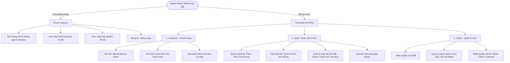
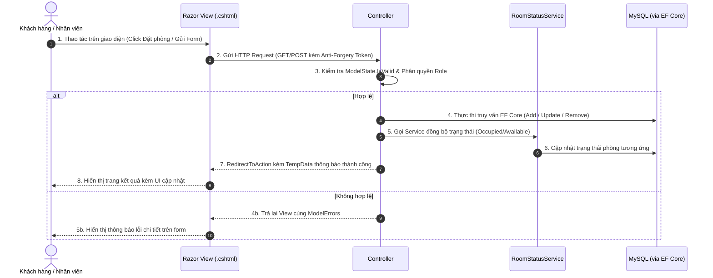
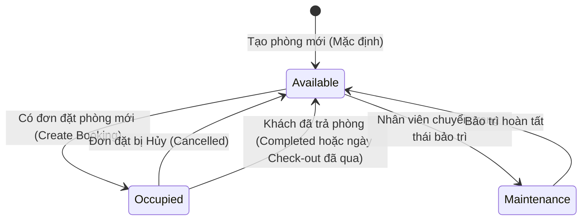
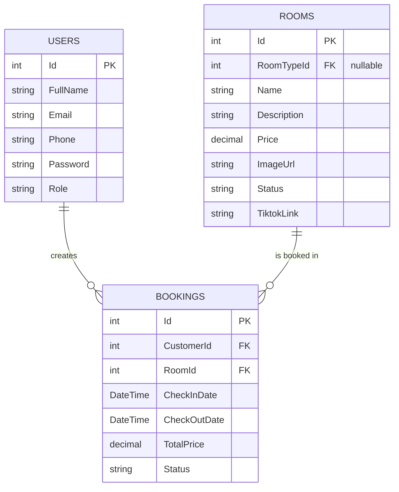
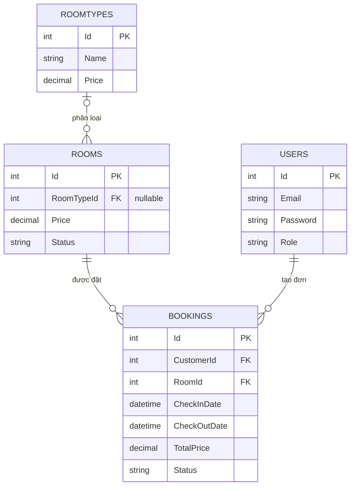
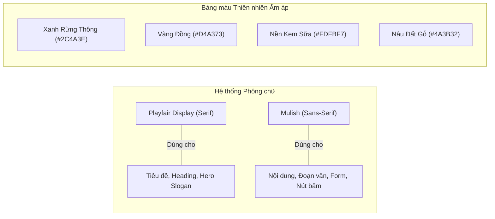

# BÁO CÁO ĐỒ ÁN & HƯỚNG DẪN VẬN HÀNH
# HỆ THỐNG QUẢN LÝ & ĐẶT PHÒNG FINN HOMESTAY

---

## MỤC LỤC
1. [I. GIỚI THIỆU TỔNG QUAN HỆ THỐNG](#i-giới-thiệu-tổng-quan-hệ-thống)
   - [1.1. Giới thiệu dự án](#11-giới-thiệu-dự-án)
   - [1.2. Mục tiêu đề tài](#12-mục-tiêu-đề-tài)
   - [1.3. Ngăn xếp công nghệ (Technology Stack)](#13-ngăn-xếp-công-nghệ-technology-stack)
   - [1.4. Phân quyền và các vai trò người dùng (User Roles)](#14-phân-quyền-và-các-vai-trò-người-dùng-user-roles)
2. [II. HƯỚNG DẪN CÀI ĐẶT & KHỞI CHẠY (SETUP GUIDE)](#ii-hướng-dẫn-cài-đặt--khởi-chạy-setup-guide)
   - [2.1. Yêu cầu môi trường & Công cụ](#21-yêu-cầu-môi-trường--công-cụ)
   - [2.2. Cấu hình chuỗi kết nối Database (Connection String)](#22-cấu-hình-chuỗi-kết-nối-database-connection-string)
   - [2.3. Khởi tạo Cơ sở dữ liệu bằng Entity Framework Core Migration](#23-khởi-tạo-cơ-sở-dữ-liệu-bằng-entity-framework-core-migration)
   - [2.4. Biên dịch và Khởi chạy ứng dụng](#24-biên-dịch-và-khởi-chạy-ứng-dụng)
   - [2.5. Danh sách tài khoản mẫu dùng cho kiểm thử (Seed Accounts)](#25-danh-sách-tài-khoản-mẫu-dùng-cho-kiểm-thử-seed-accounts)
3. [III. KIẾN TRÚC HỆ THỐNG & LUỒNG HOẠT ĐỘNG (CRUD WORKFLOWS)](#iii-kiến-trúc-hệ-thống--luồng-hoạt-động-crud-workflows)
   - [3.1. Mô hình kiến trúc MVC (Model - View - Controller)](#31-mô-hình-kiến-trúc-mvc-model---view---controller)
   - [3.2. Cơ chế Xác thực & Phân quyền (Cookie Authentication & Authorization)](#32-cơ-chế-xác-thực--phân-quyền-cookie-authentication--authorization)
   - [3.3. Phân tích Luồng CRUD Quản lý Phòng (Room Management)](#33-phân-tích-luồng-crud-quản-lý-phòng-room-management)
   - [3.4. Phân tích Luồng CRUD Quản lý Đơn đặt phòng (Booking Management)](#34-phân-tích-luồng-crud-quản-lý-đơn-đặt-phòng-booking-management)
   - [3.5. Phân tích Luồng CRUD Quản lý Tài khoản (User Management)](#35-phân-tích-luồng-crud-quản-lý-tài-khoản-user-management)
   - [3.6. Phân tích Luồng CRUD Quản lý Loại phòng](#36-phân-tích-luồng-crud-quản-lý-loại-phòng)
   - [3.7. Cách hoạt động của Cơ sở dữ liệu](#37-cách-hoạt-động-của-cơ-sở-dữ-liệu)
4. [IV. THIẾT KẾ GIAO DIỆN & TRẢI NGHIỆM NGƯỜI DÙNG (UI/UX DESIGN)](#iv-thiết-kế-giao-diện--trải-nghiệm-người-dùng-uiux-design)
   - [4.1. Định hướng phong cách thiết kế (Modern Cozy Homestay)](#41-định-hướng-phong-cách-thiết-kế-modern-cozy-homestay)
   - [4.2. Giải pháp kỹ thuật: Custom CSS Override thay vì Bootstrap thuần](#42-giải-pháp-kỹ-thuật-custom-css-override-thay-vì-bootstrap-thuần)
   - [4.3. Nghệ thuật Typography & Phối màu](#43-nghệ-thuật-typography--phối-màu)
   - [4.4. Micro-interactions & Trải nghiệm thực tế](#44-micro-interactions--trải-nghiệm-thực-tế)
   - [4.5. Bố cục tổng thể và giao diện từng trang](#45-bố-cục-tổng-thể-và-giao-diện-từng-trang)
   - [4.6. Giao diện các màn quản lý và cách người dùng thao tác](#46-giao-diện-các-màn-quản-lý-và-cách-người-dùng-thao-tác)
5. [V. KẾT LUẬN & ĐÁNH GIÁ](#v-kết-luận--đánh-giá)

---

# I. GIỚI THIỆU TỔNG QUAN HỆ THỐNG

### 1.1. Giới thiệu dự án
- **Tên hệ thống:** Website Giới thiệu & Đặt phòng trực tuyến Finn Homestay.
- **Bối cảnh:** Finn Homestay là một mô hình nghỉ dưỡng ấm cúng, thư thái tọa lạc tại khu vực biển đảo (địa chỉ thực tế: *36 đường ven biển, Lại Sơn, An Giang*). Dự án được xây dựng dưới dạng Đồ án môn học / Niên luận Công nghệ Thông tin nhằm giải quyết bài toán chuyển đổi số: giới thiệu không gian homestay trực quan, số hóa quy trình quản lý phòng và tiếp nhận đơn đặt phòng trực tuyến từ khách hàng.

### 1.2. Mục tiêu đề tài
1. Xây dựng một cổng thông tin trực tuyến có tính thẩm mỹ cao, tạo cảm xúc ấm cúng, thân thiện (*Cozy & Peaceful*) ngay khi người dùng truy cập.
2. Cung cấp quy trình đặt phòng khép kín: Khách hàng tìm phòng $\rightarrow$ Xem chi tiết / Xem video TikTok thực tế $\rightarrow$ Tạo đơn đặt phòng $\rightarrow$ Nhân viên tiếp nhận xét duyệt.
3. Hỗ trợ Staff/Admin quản lý danh mục phòng, theo dõi lịch đặt, phòng ngừa trùng lịch (*Overlapping Prevention*), tự động hóa việc tính giá và cập nhật trạng thái phòng.
4. Quản lý phân quyền chặt chẽ giữa 3 cấp độ: Khách hàng (Customer), Nhân viên lễ tân (Staff), Quản trị viên (Admin).

### 1.3. Ngăn xếp công nghệ (Technology Stack)

| Thành phần | Công nghệ / Thư viện sử dụng | Vai trò & Đặc điểm |
| :--- | :--- | :--- |
| **Nền tảng chính** | `.NET 10.0` (C# 13/14) | Framework backend hiện đại, hiệu năng cao, hỗ trợ Dependency Injection mạnh mẽ |
| **Kiến trúc web** | `ASP.NET Core MVC` | Mô hình phân lớp Controller - View - Model tường minh, dễ bảo trì |
| **ORM & CSDL** | `Entity Framework Core 9.0.2` & `Pomelo.EntityFrameworkCore.MySql` | Code-First ORM, tự động sinh Migration và đồng bộ schema |
| **Cơ sở dữ liệu** | `MySQL 8.x` | Hệ quản trị cơ sở dữ liệu quan hệ mạnh mẽ, chuẩn mực |
| **Xác thực** | `Cookie Authentication` | Cơ chế xác thực thông qua HTTP Cookie và ClaimsPrincipal (không phụ thuộc Identity cồng kềnh) |
| **Giao diện (Frontend)** | `Razor Views`, `HTML5`, `CSS3`, `JavaScript (Vanilla ES6)` | Server-side rendering tốc độ cao, hỗ trợ dynamic DOM scripting |
| **Thư viện UI** | `Bootstrap 5.3`, `FontAwesome 6.5` | Hệ thống lưới responsive và kho biểu tượng trực quan |
| **Phông chữ** | Google Fonts: `Playfair Display` + `Mulish` | Định hình phong cách thiết kế sang trọng, ấm cúng |

### 1.4. Phân quyền và các vai trò người dùng (User Roles)

Hệ thống thiết kế theo cơ chế **RBAC (Role-Based Access Control)** với 3 vai trò phân cấp rõ ràng:



---

# II. HƯỚNG DẪN CÀI ĐẶT & KHỞI CHẠY (SETUP GUIDE)

### 2.1. Yêu cầu môi trường & Công cụ
Để chạy được project trên máy tính cá nhân hoặc phòng máy thực hành, bạn cần chuẩn bị:
1. **.NET SDK:** Phiên bản `.NET 10.0 SDK` (hoặc tương thích mới nhất của Microsoft).
   - Kiểm tra bằng lệnh: `dotnet --version`
2. **Cơ sở dữ liệu:** `MySQL Server 8.0+` (hoặc thông qua XAMPP / WampServer / Docker).
   - Đảm bảo MySQL Service đang chạy trên cổng mặc định `3306`.
3. **Công cụ phát triển (IDE khuyến nghị):**
   - Visual Studio 2026 / Visual Studio Code / JetBrains Rider.
   - EF Core Tools CLI: Kiểm tra bằng `dotnet ef --version`. Nếu chưa có, cài đặt bằng:
     ```bash
     dotnet tool install --global dotnet-ef
     ```

### 2.2. Cấu hình chuỗi kết nối Database (Connection String)
Mở file [appsettings.Development.json](file:///d:/code/FinnHomestay/appsettings.Development.json) hoặc [appsettings.json](file:///d:/code/FinnHomestay/appsettings.json) tại thư mục gốc, điều chỉnh lại mật khẩu MySQL của máy bạn:

```json
{
  "ConnectionStrings": {
    "DefaultConnection": "Server=localhost;Port=3306;Database=FinnHomestayDb;Uid=root;Pwd=12345;"
  }
}
```
> **Lưu ý:**
> - `Server=localhost;Port=3306`: Địa chỉ máy chủ MySQL cục bộ.
> - `Database=FinnHomestayDb`: Tên CSDL hệ thống sẽ tự động tạo.
> - `Uid=root`: Tên tài khoản quản trị MySQL.
> - `Pwd=...`: Đổi `12345` thành mật khẩu root MySQL trên máy tính của bạn (nếu dùng XAMPP mặc định mật khẩu là rỗng: `Pwd=;`).

### 2.3. Khởi tạo Cơ sở dữ liệu bằng Entity Framework Core Migration
Hệ thống sử dụng cơ chế **Code-First**. Bạn không cần phải tạo bảng thủ công bằng file `.sql`. Chỉ cần mở Terminal tại thư mục gốc của project (`d:\code\FinnHomestay`) và chạy lệnh sau:

```bash
dotnet ef database update
```

**Quá trình thực thi:**
- Entity Framework Core sẽ kết nối tới MySQL, tự động tạo cơ sở dữ liệu `FinnHomestayDb` (nếu chưa có).
- Chạy lần lượt các Migration:
  1. `20261116115930_InitialCreate`: Tạo bảng `Users`, `Rooms`, `Bookings`.
  2. `20261119011618_AddTiktokLinkToRoom`: Thêm cột `TiktokLink` vào bảng `Rooms`.
  3. `20261119134248_AddRoomType`: Tạo bảng `RoomTypes`, thêm cột nullable `Rooms.RoomTypeId` và khóa ngoại.
- Tạo bảng quản lý lịch sử `__EFMigrationsHistory`.

> Database phát triển hiện đã ghi nhận migration `AddRoomType`. Nếu migration này đã có trong `__EFMigrationsHistory`, EF Core sẽ không chạy lại; lệnh chỉ áp dụng các migration còn thiếu.

### 2.4. Biên dịch và Khởi chạy ứng dụng
Chạy lệnh sau tại cửa sổ dòng lệnh:

```bash
dotnet run
```
Sau khi server khởi động thành công, console sẽ hiển thị thông báo:
```text
info: Microsoft.Hosting.Lifetime[14]
      Now listening on: http://localhost:5038
info: Microsoft.Hosting.Lifetime[0]
      Application started. Press Ctrl+C to shut down.
```
Mở trình duyệt bất kỳ (Chrome, Edge) và truy cập đường dẫn: **`http://localhost:5038`**

### 2.5. Danh sách tài khoản mẫu dùng cho kiểm thử (Seed Accounts)
Hệ thống tạo tài khoản mẫu khi mở trang đăng nhập nếu chưa có tài khoản tương ứng từng vai trò. Phòng mẫu được tạo khi mở trang tạo đơn đặt phòng nếu bảng phòng đang trống. Đây là seed theo các luồng trang tương ứng, không phải seed tổng quát ngay khi ứng dụng khởi động:

| Vai trò (Role) | Email đăng nhập | Mật khẩu | Quyền hạn nổi bật |
| :--- | :--- | :--- | :--- |
| **Admin** | `admin@finnhomestay.com` | `123456` | Toàn quyền hệ thống: Quản lý phòng, đơn đặt, và phân quyền tài khoản |
| **Staff** | `staff@finnhomestay.com` | `123456` | Quản lý phòng (CRUD, sửa video TikTok) & Duyệt/Check-out đơn đặt |
| **Customer** | `customer@finnhomestay.com` | `123456` | Xem phòng, đặt phòng, theo dõi và hủy đơn đặt của chính mình |

---

# III. KIẾN TRÚC HỆ THỐNG & LUỒNG HOẠT ĐỘNG (CRUD WORKFLOWS)

### 3.1. Mô hình kiến trúc MVC (Model - View - Controller)

Hệ thống tuân thủ chặt chẽ nguyên lý **Separation of Concerns (Phân tách mối quan tâm)** của ASP.NET Core MVC:

```
FinnHomestay/
├── Controllers/         # Tiếp nhận HTTP Request, xử lý điều hướng & gọi Service/Db
│   ├── AuthController.cs
│   ├── HomeController.cs
│   ├── RoomController.cs
│   ├── RoomTypeController.cs
│   ├── BookingController.cs
│   └── UserController.cs
├── Models/              # Thực thể cơ sở dữ liệu và các ViewModels chứa dữ liệu validation
│   ├── Room.cs
│   ├── RoomType.cs
│   ├── Booking.cs
│   ├── User.cs
│   ├── AuthViewModels.cs
│   └── UserViewModels.cs
├── Views/               # Giao diện hiển thị Razor (.cshtml)
│   ├── Home/
│   ├── Room/
│   ├── RoomType/
│   ├── Booking/
│   ├── User/
│   └── Shared/
├── Services/            # Tầng nghiệp vụ độc lập (Business Logic Layer)
│   ├── IRoomStatusService.cs
│   └── RoomStatusService.cs
├── Data/                # DbContext quản lý kết nối CSDL và cấu hình Fluent API
│   └── AppDbContext.cs
└── wwwroot/             # Tài nguyên tĩnh: CSS tùy biến, JavaScript, hình ảnh homestay
```



---

### 3.2. Cơ chế Xác thực & Phân quyền (Cookie Authentication & Authorization)
Dự án không sử dụng thư viện ASP.NET Core Identity mặc định nhằm giữ cho cấu trúc CSDL gọn gàng, phù hợp đồ án đại học. Thay vào đó, hệ thống sử dụng **Cookie Authentication thuần túy**:

1. **Đăng nhập (`AuthController.Login`):**
   - Khi người dùng gửi Email và Mật khẩu, controller tìm kiếm User trong DB.
   - Kiểm tra mật khẩu (hỗ trợ so sánh mã băm SHA-256).
   - Nếu chính xác, khởi tạo một danh sách các `Claim`:
     ```csharp
     var claims = new List<Claim>
     {
         new Claim(ClaimTypes.NameIdentifier, user.Id.ToString()),
         new Claim(ClaimTypes.Name, user.FullName),
         new Claim(ClaimTypes.Email, user.Email),
         new Claim(ClaimTypes.Role, user.Role) // Admin, Staff hoặc Customer
     };
     ```
   - Tạo `ClaimsIdentity` và ghi xuống phiên trình duyệt bằng `HttpContext.SignInAsync()`.
2. **Bảo vệ Endpoint bằng Attribute `[Authorize]`:**
   - `[Authorize]`: Bắt buộc người dùng phải đăng nhập mới được truy cập.
   - `[Authorize(Roles = "Admin, Staff")]`: Chỉ tài khoản có vai trò Admin hoặc Staff mới được thêm/sửa/xóa phòng.
   - `[Authorize(Roles = "Admin")]`: Chỉ riêng Admin mới được quản lý tài khoản và phân quyền.
3. **Bảo mật Form:** Mọi form `POST` đều được áp dụng `[ValidateAntiForgeryToken]` nhằm ngăn chặn tấn công giả mạo yêu cầu chéo trang (CSRF).

---

### 3.3. Phân tích Luồng CRUD Quản lý Phòng (Room Management)

Thực thể `Room` bao gồm: `Id`, `Name`, `Description`, `Price`, `ImageUrl`, `Status`, `TiktokLink` và `RoomTypeId` tùy chọn. Giá phòng cụ thể (`Room.Price`) là giá được dùng để tính đơn đặt; giá ở loại phòng (`RoomType.Price`) là giá cơ bản hiển thị khi giới thiệu hạng phòng.

#### Luồng thao tác tại các trang Phòng
1. **Danh sách (`Room/Index`)**: GET đồng bộ trạng thái phòng, tìm theo tên nếu có từ khóa, rồi nạp danh sách cùng loại phòng bằng `Include(r => r.RoomType)`. Bảng có ảnh, tên, loại phòng, mô tả, giá, trạng thái và thao tác Xem/Sửa/Xóa. Khi không có dữ liệu, View hiển thị trạng thái rỗng.
2. **Thêm (`Room/Create`)**: GET nạp `RoomTypes` vào `ViewBag.RoomTypes` cho thẻ chọn loại. POST nhận form, kiểm tra Data Annotations và `ModelState`; hợp lệ thì `_context.Rooms.Add` và `SaveChangesAsync`, rồi quay về danh sách cùng thông báo. Không chọn loại thì `RoomTypeId` là null, phù hợp dữ liệu phòng cũ.
3. **Xem (`Room/Details/{id}`)**: Controller tìm phòng theo ID, nạp Booking liên quan và đồng bộ trạng thái. View trình bày ảnh, giá, mô tả, tiện ích, trạng thái và link TikTok. Admin/Staff có thể vào Sửa; phòng còn trống có nút chuyển sang tạo đơn.
4. **Sửa (`Room/Edit/{id}`)**: GET tải phòng cùng danh sách loại để chọn sẵn giá trị hiện tại. POST kiểm tra ID và dữ liệu, cập nhật bằng EF Core; nếu validation thất bại, Controller nạp lại dropdown rồi trả về form.
5. **Xóa (`POST Room/Delete/{id}`)**: Controller kiểm tra Room có Booking hay chưa. Nếu có, thao tác bị từ chối và hiển thị thông báo; nếu không, xóa Room và báo thành công.



#### Các điểm sáng công nghệ:
1. **Lưu trữ Link Video TikTok (`TiktokLink`):**
   - Hỗ trợ nhân viên dán link video review phòng trên TikTok (ví dụ: `https://www.tiktok.com/@finnhomestay/video/73456789...`).
   - Cung cấp trải nghiệm sinh động: khách hàng có thể bấm xem video không gian thực tế trước khi đặt.
2. **Tự động đồng bộ trạng thái phòng (`RoomStatusService`):**
   - **Khi tạo đơn đặt phòng mới:** Hệ thống gọi `_roomStatusService.MarkRoomAsOccupiedAsync(roomId)`. Phòng ngay lập tức chuyển từ `Available` ("Còn trống") sang `Occupied` ("Đã đặt").
   - **Khi đơn bị hủy / xóa / hoặc khách check-out:** Gọi `_roomStatusService.SyncRoomStatusAsync(roomId)`. Nếu phòng không còn đơn nào có hiệu lực trong tương lai, phòng tự động trở về `Available`.
   - **Tự động quét khi load trang:** Khi nhân viên hoặc khách truy cập trang chủ / danh sách phòng, hệ thống tự động quét các đơn có `CheckOutDate <= Today` để giải phóng phòng, đảm bảo thông tin luôn chính xác theo thời gian thực mà không cần người dùng thao tác thủ công.
3. **Giao diện bảng điều khiển:**
   - Riêng bảng Phòng, ba nút **Xem - Sửa - Xóa** dùng kích thước `72px x 32px`, bo góc `6px`, icon FontAwesome và hiệu ứng hover nhất quán.

---

### 3.4. Phân tích Luồng CRUD Quản lý Đơn đặt phòng (Booking Management)

Thực thể `Booking` là trung tâm nghiệp vụ, liên kết hai khóa ngoại:
- `CustomerId` $\rightarrow$ Trỏ tới `User` (Khách hàng thực hiện đơn).
- `RoomId` $\rightarrow$ Trỏ tới `Room` (Phòng được đặt).



#### Quy tắc nghiệp vụ (Business Rules) áp dụng trong Controller:
1. **Kiểm tra tính hợp lệ của ngày lưu trú:**
   - `CheckOutDate` bắt buộc phải sau `CheckInDate`. Nếu không, `ModelState.AddModelError` sẽ chặn lại và báo lỗi rõ ràng.
2. **Tự động tính tổng tiền (Auto Calculation):**
   - Công thức: $\text{Tổng tiền} = \text{Giá phòng} \times \text{Số đêm lưu trú}$.
   - Hỗ trợ nút bấm **⚡ Tự tính** trên giao diện bằng JavaScript để khách hàng xem trước giá, đồng thời Backend cũng tự động kiểm tra và tính lại trước khi lưu vào CSDL (phòng ngừa gian lận giá từ client).
3. **Chống trùng lịch (Overlapping Prevention):**
   - Khi đơn ở trạng thái `Confirmed`, hệ thống truy vấn kiểm tra xem trong khoảng thời gian `[CheckInDate, CheckOutDate]` phòng đó đã có đơn `Confirmed` nào khác chiếm chỗ chưa:
     ```csharp
     var isOverlap = await _context.Bookings.AnyAsync(b =>
         b.Id != booking.Id &&
         b.RoomId == booking.RoomId &&
         b.Status == "Confirmed" &&
         b.CheckInDate < booking.CheckOutDate &&
         b.CheckOutDate > booking.CheckInDate);
     ```
4. **Bảo mật phân quyền dữ liệu khách hàng:**
   - Nếu người dùng là `Customer`: Controller tự động gán `CustomerId = GetCurrentUserId()` lấy từ Cookie Claims của hệ thống, tuyệt đối không cho phép khách hàng giả mạo ID người khác bằng cách sửa mã HTML form. Khách hàng chỉ được phép xem và thao tác trên chính đơn đặt của họ.

#### Luồng thao tác tại các trang Đơn đặt phòng
1. **Danh sách (`Booking/Index`)**: Controller đồng bộ trạng thái phòng, nạp Booking cùng Room và Customer, sau đó lọc theo trạng thái/từ khóa. Customer chỉ xem đơn có `CustomerId` của mình; Staff/Admin xem toàn bộ. Danh sách chứa thao tác sửa/xóa; dự án không có trang Details riêng cho Booking.
2. **Tạo (`Booking/Create`)**: GET có thể nhận `roomId` từ nút đặt phòng, nạp dropdown phòng và khách hàng cùng giá/link TikTok để hỗ trợ người dùng. Customer chỉ thấy danh tính của mình; Staff/Admin chọn khách. POST gán lại ID Customer từ Claims, xác thực ngày, phòng, giá và lịch trùng trước khi Add/SaveChanges. Sau khi lưu, RoomStatusService đánh dấu phòng bận.
3. **Sửa (`Booking/Edit`)**: GET tải đơn cùng phòng/khách và kiểm tra quyền sở hữu. POST không cho Customer đổi chủ đơn hoặc trạng thái, kiểm tra ngày và xung đột lịch, cập nhật bản ghi. Sau đó dịch vụ đồng bộ phòng hiện tại và cả phòng cũ nếu đơn đổi phòng.
4. **Xóa (`Booking/Delete`)**: POST xác minh đơn và quyền sở hữu; sau khi xóa Booking, dịch vụ tính lại trạng thái phòng. Phòng trở về Available khi không còn đơn có hiệu lực và không đang bảo trì.

---

### 3.5. Phân tích Luồng CRUD Quản lý Tài khoản (User Management)
- **Chỉ dành riêng cho Admin:** Bảo vệ bằng `[Authorize(Roles = "Admin")]`.
- **Băm mật khẩu trong các luồng tạo tài khoản:**
  Đăng ký và tạo tài khoản từ trang quản lý gọi hàm SHA-256 và lưu chuỗi hex. Mã hiện tại tương đương:
  ```csharp
  private static string HashPassword(string password)
  {
      var bytes = Encoding.UTF8.GetBytes(password);
      var hash = SHA256.HashData(bytes);
      return Convert.ToHexString(hash);
  }
  ```
  Tài khoản mẫu được seed với mật khẩu `123456` dạng văn bản để thuận tiện trình diễn; màn đăng nhập hiện hỗ trợ so sánh cả mật khẩu mẫu này lẫn chuỗi băm.
- **Kiểm soát ràng buộc toàn vẹn dữ liệu:**
  - Không cho phép xóa tài khoản nếu người dùng đó đã từng phát sinh dữ liệu đơn đặt phòng (`Bookings`) trong hệ thống, tránh lỗi vỡ quan hệ toàn vẹn trong MySQL (`DeleteBehavior.Restrict`).

#### Luồng thao tác tại các trang Tài khoản
1. **Danh sách (`User/Index`)**: Chỉ Admin được truy cập. GET có thể tìm theo họ tên, email hoặc số điện thoại; bảng hiển thị liên hệ, vai trò và thao tác chỉnh sửa/xóa.
2. **Tạo (`User/Create`)**: GET hiển thị `UserCreateViewModel`. POST xác thực dữ liệu và kiểm tra email trùng; mật khẩu được băm SHA-256 dạng chuỗi hex trước khi thêm User vào database.
3. **Sửa (`User/Edit/{id}`)**: GET đưa thông tin hồ sơ vào `UserEditViewModel`, không hiển thị mật khẩu cũ. POST kiểm tra email không trùng tài khoản khác, cập nhật họ tên/email/điện thoại/vai trò. Chỉ khi nhập mật khẩu mới thì mật khẩu mới được băm và lưu; để trống thì giữ nguyên.
4. **Xóa (`User/Delete/{id}`)**: POST cấm Admin xóa tài khoản đang đăng nhập và từ chối xóa người dùng đã có Booking. Nếu đủ điều kiện, EF Core xóa bản ghi và Controller chuyển về Index kèm thông báo.

### 3.6. Phân tích Luồng CRUD Quản lý Loại phòng

`RoomType` lưu thông tin dùng để giới thiệu và phân nhóm phòng: `Id`, `Name`, `Description`, `Price`, `ImageUrl`, `TiktokLink`. Một loại có thể gắn với nhiều Room; `Room.RoomTypeId` dùng `int?`, nên các phòng cũ không bắt buộc phải có loại.

1. **Danh sách (`RoomType/Index`)**: Chỉ Admin/Staff truy cập. Controller lấy các loại phòng theo tên; View trình bày ảnh, tên, giá cơ bản, mô tả và nút Sửa/Xóa đồng cỡ. Khi danh sách trống, trang hiển thị gợi ý tạo loại đầu tiên.
2. **Tạo (`RoomType/Create`)**: GET mở form. POST xác thực tên bắt buộc, độ dài tối đa 100 ký tự và giá không âm; hợp lệ thì Add/SaveChangesAsync và chuyển về danh sách, nếu sai trả form cùng lỗi validation.
3. **Sửa (`RoomType/Edit/{id}`)**: GET tìm theo ID và điền dữ liệu cũ. POST kiểm tra ID/ModelState rồi Update/SaveChanges; nếu không tìm thấy thì trả NotFound.
4. **Xóa (`RoomType/Delete/{id}`)**: Form POST gửi Anti-Forgery Token và yêu cầu xác nhận. Khóa ngoại `ON DELETE SET NULL` giữ nguyên các Room đang thuộc loại bị xóa, chỉ đặt `RoomTypeId` thành null.
5. **Đưa ra trang khách**: `Home/Index` truyền RoomTypes sang View để dựng card ảnh/tên/giá/mô tả. Card dẫn đến `Home/RoomTypeDetails?id=...`; trang chi tiết chỉ lấy các Room có đúng loại và `Status == "Available"`, mỗi phòng có liên kết tới `Booking/Create?roomId=...`.

### 3.7. Cách hoạt động của Cơ sở dữ liệu

#### Bốn bảng nghiệp vụ chính
- **`Users`**: hồ sơ đăng nhập, email, điện thoại, mật khẩu và Role (`Admin`, `Staff`, `Customer`).
- **`RoomTypes`**: danh mục loại phòng, giá cơ bản, mô tả, ảnh và link TikTok.
- **`Rooms`**: từng phòng thực tế, giá/đêm, trạng thái, ảnh/TikTok và khóa ngoại `RoomTypeId` có thể để trống.
- **`Bookings`**: đơn đặt, gồm khóa ngoại khách hàng/phòng, ngày check-in/check-out, tổng tiền và trạng thái.
- **`__EFMigrationsHistory`**: bảng hệ thống của EF Core ghi các migration đã áp dụng.

#### Sơ đồ quan hệ


`RoomType–Room` là quan hệ một-nhiều tùy chọn ở phía Room. `User–Booking` và `Room–Booking` là một-nhiều, mỗi Booking phải tham chiếu một User và một Room. Hai khóa ngoại của Booking dùng `DeleteBehavior.Restrict` để không xóa nhầm dữ liệu đã có lịch sử; RoomType dùng `SetNull` để xóa danh mục mà không xóa phòng.

#### Luồng dữ liệu qua Entity Framework Core
1. `Program.cs` đăng ký `AppDbContext` và Pomelo MySQL provider bằng chuỗi `DefaultConnection`.
2. ASP.NET Core cấp `AppDbContext` cho Controller qua Dependency Injection. Controller viết LINQ trực tiếp trên `_context.Rooms`, `_context.RoomTypes`, `_context.Bookings` hoặc `_context.Users`.
3. Các hàm như `ToListAsync`, `FirstOrDefaultAsync`, `FindAsync`, `AnyAsync` thực hiện truy vấn đọc. `Include` nạp navigation property để View có thể hiển thị tên loại phòng, khách hoặc phòng liên quan.
4. Khi tạo/sửa/xóa, EF theo dõi thao tác `Add`, `Update`, `Remove`. `SaveChangesAsync` chuyển các thay đổi thành SQL và gửi đến MySQL.
5. Controller trả Model/ViewBag cho Razor View; View không tự kết nối database. Khi form được gửi lại bằng POST, Controller kiểm tra dữ liệu và quyền trước khi ghi.

#### Migration và ràng buộc dữ liệu
- Migration được sinh từ khác biệt giữa Model hiện tại và `AppDbContextModelSnapshot`. Lệnh `dotnet ef migrations add <Tên>` tạo phương thức `Up` để áp dụng và `Down` để hoàn tác.
- `dotnet ef database update` đối chiếu migration trong mã nguồn với `__EFMigrationsHistory`, sau đó chỉ chạy các thay đổi chưa được áp dụng.
- Các cột tiền `Room.Price`, `RoomType.Price`, `Booking.TotalPrice` được cấu hình `decimal(18,2)`; ID tự tăng do MySQL tạo.
- Ràng buộc quan hệ ở database bảo vệ liên kết ngay cả khi có thao tác ngoài giao diện. Controller bổ sung kiểm tra nghiệp vụ như không xóa phòng có Booking, không xóa tài khoản đã có đơn và ngăn booking trùng lịch.

---

# IV. THIẾT KẾ GIAO DIỆN & TRẢI NGHIỆM NGƯỜI DÙNG (UI/UX DESIGN)

### 4.1. Định hướng phong cách thiết kế (Modern Cozy Homestay)
Khác với các trang quản trị hành chính khô khan hoặc các khách sạn thương mại công nghiệp, Finn Homestay hướng đến cảm xúc **"Ấm cúng, mộc mạc và an yên"** (*Cozy & Peaceful Retreat*). Giao diện mang hơi thở thiên nhiên biển đảo với màu xanh ngọc bích, màu gỗ trầm ấm và điểm xuyết ánh vàng đồng sang trọng.

### 4.2. Giải pháp kỹ thuật: Custom CSS Override thay vì Bootstrap thuần
Nhiều đồ án sinh viên thường bị lỗi giao diện "đại trà", nhàm chán do lạm dụng 100% component mặc định của Bootstrap. Trong dự án Finn Homestay:
- **Bootstrap 5.3** chỉ đóng vai trò làm khung nền tảng: Cung cấp hệ thống lưới Responsive (`container`, `row`, `col`), Reset CSS và các tiện ích flex cơ bản.
- **Toàn bộ thẩm mỹ được Custom Override qua file [wwwroot/css/site.css](file:///d:/code/FinnHomestay/wwwroot/css/site.css)** (hơn 930 dòng code CSS được xây dựng công phu):
  - Định nghĩa lại toàn bộ hệ thống biến màu sắc CSS `:root`.
  - Thiết kế lại Card phòng với viền bo góc lớn `border-radius: 16px`, không đường viền viền thô, sử dụng bóng đổ nhiều tầng (*multi-layer soft shadows*).
  - Tùy biến Hero Banner với chiều cao `80vh` và cạnh đáy uốn lượn mềm mại (`border-bottom-left-radius: 40px`, `border-bottom-right-radius: 40px`).
  - Đồng bộ hệ thống nút bấm thao tác trên tất cả các bảng dữ liệu bằng class chung `.btn-action-custom` / `.btn-action-room`.

### 4.3. Nghệ thuật Typography & Phối màu



- **Sự kết hợp hoàn hảo giữa 2 phông chữ:**
  - `Playfair Display`: Phông chữ có chân mang nét hoài niệm, sang trọng và thanh lịch, gợi cảm giác nghỉ dưỡng cao cấp.
  - `Mulish`: Phông chữ không chân hiện đại, nét chữ tròn trịa, cực kỳ dễ đọc trên màn hình điện thoại và máy tính.
- **Bảng màu:**
  - Nền trang web không sử dụng màu trắng tinh `#FFFFFF` gây chói mắt, mà sử dụng màu kem dịu nhẹ `#FDFBF7`.
  - Màu chủ đạo là xanh trầm thiên nhiên `#2C4A3E` kết hợp điểm nhấn ánh vàng đồng `#D4A373`.

### 4.4. Micro-interactions & Trải nghiệm thực tế
1. **Hiệu ứng Hover Zoom & Nâng thẻ (Card Lift):**
   Khi rê chuột vào các card phòng trên trang chủ, hình ảnh nhẹ nhàng phóng to `scale(1.06)` và thẻ phòng được nhấc nhẹ lên khỏi mặt phẳng `transform: translateY(-6px)`, tạo cảm giác chiều sâu 3D chân thực.
2. **Nút bấm TikTok trực quan (Badge TikTok):**
   Ở trang chi tiết phòng và form tạo đơn, nếu phòng có link TikTok thì người dùng có thể mở video review trong tab mới. Trang chi tiết loại phòng cũng có nút video khi `TiktokLink` được nhập.
3. **Nút thao tác trong bảng:**
   Bảng Phòng dùng nút Xem/Sửa/Xóa kích thước `72px x 32px`, căn giữa bằng Flexbox, bo góc `6px`; khi rê chuột, nút nâng nhẹ `translateY(-1px)` và tăng bóng. Bảng Loại phòng đặt hai nút Sửa/Xóa cùng chiều rộng tối thiểu `76px`, chiều cao `44px`. Booking/User sử dụng class và kích thước khai báo trong từng View.

---

### 4.5. Bố cục tổng thể và giao diện từng trang

#### Khung dùng chung trên toàn website
- **Thanh điều hướng trên cùng** nằm trong `_Layout.cshtml`: logo Finn Homestay và Trang chủ luôn hiển thị; Admin/Staff thấy Quản lý Loại phòng và Quản lý Phòng; Booking là lối vào cho phần đơn; Admin có thêm Quản lý Tài khoản. Bên phải là menu đăng nhập/đăng ký hoặc tên, vai trò và đăng xuất khi đã đăng nhập. Trên màn hình nhỏ, menu thu gọn bằng nút hamburger của Bootstrap.
- **Vùng nội dung chính** có hai cách bố trí. Trang chủ đặt `IsFullWidth=true` để Hero và các section trải rộng hết khung; các trang còn lại nằm trong `container` có lề và khoảng đệm dọc, nhờ đó form và bảng không áp sát mép màn hình.
- **Footer** dùng chung, chia cột giới thiệu thương hiệu, liên kết khám phá, giờ giấc và thông tin liên hệ. Các thư viện Bootstrap, Font Awesome và `site.css` được nạp tại layout để giữ nhận diện xuyên suốt.

#### Trang chủ (`Home/Index`)
Các phần được xếp theo thứ tự cuộn từ trên xuống:
1. **Hero banner** với slogan “CHỐN BÌNH YÊN GIỮA ĐẢO XANH”, tiêu đề, đoạn giới thiệu và nút cuộn đến khu phòng/giới thiệu.
2. **Dải tiện ích** hiển thị Wi-Fi, cà phê, bếp và an toàn qua các ô icon ngắn gọn.
3. **Phần giới thiệu** kết hợp nội dung và ảnh không gian, nhấn vào sự yên tĩnh và trải nghiệm homestay.
4. **Card Loại phòng nổi bật** trình bày ảnh, tên, giá cơ bản và mô tả ngắn. Nút “Xem chi tiết & Đặt phòng” mở trang chi tiết loại.
5. **Card Phòng nghỉ nổi bật** trình bày ảnh, trạng thái, tên, mô tả, tiện ích, giá từng đêm và nút đặt nếu phòng Available. Nếu phòng bận/bảo trì, nút đặt bị thay bằng trạng thái tương ứng.

#### Trang xem phòng và trang chi tiết loại phòng
- **`Room/Index`** là danh sách phòng công khai đồng thời là bảng thao tác nội bộ cho Admin/Staff. Có tìm kiếm theo tên, ảnh thu nhỏ, tên loại phòng, giá, badge trạng thái và các nút Xem/Sửa/Xóa; trạng thái hiển thị cho biết phòng còn trống, đã đặt hay bảo trì.
- **`Room/Details`** dùng một card ảnh lớn làm trọng tâm, đặt trạng thái trên ảnh; bên dưới có giá, link TikTok, mô tả và tiện ích. Khách thấy nút đặt khi phòng trống, nhân viên có nút sửa.
- **`Home/RoomTypeDetails`** mở đầu bằng breadcrumb, ảnh lớn và khối thông tin loại phòng (tên, giá cơ bản, mô tả, link review). Phần sau là các card phòng thuộc loại còn Available; mỗi card cho biết tên/giá và có nút đặt. Nếu chưa có phòng phù hợp, trang nêu trạng thái rỗng thay vì để vùng nội dung trống.

#### Trang xác thực và đơn đặt
- **Đăng nhập/đăng ký** dùng form Bootstrap có nhãn, trường nhập và thông báo validation. Đăng ký công khai luôn tạo Customer; chọn vai trò cao hơn chỉ có ở màn Admin quản lý tài khoản.
- **`Booking/Index`** thay tiêu đề theo vai trò: “Đơn đặt của bạn” cho Customer và “Quản lý Đơn đặt phòng” cho Staff/Admin. Phía trên bảng là tìm kiếm và lọc trạng thái; kết quả hiển thị người đặt, phòng, ngày, tổng tiền và tình trạng cùng thao tác được phép.
- **`Booking/Create`** bố trí form theo từng trường: khách hàng (ẩn ID đối với Customer, chọn danh sách với nhân viên), phòng, check-in/check-out, trạng thái và tổng tiền. Các lỗi ngày/giá được phản hồi cạnh form; khi phòng có TikTok, khách có thể mở video để xem trước.
- **`Booking/Edit`** nạp lại thông tin hiện tại. Customer chỉ được điều chỉnh đơn của chính mình theo các trường giao diện cho phép; Staff/Admin có thể xử lý đơn và trạng thái. Các kiểm tra cuối cùng vẫn diễn ra trong Controller.

### 4.6. Giao diện các màn quản lý và cách người dùng thao tác

| Màn quản lý | Bố cục giao diện | Chu trình người dùng và phản hồi |
| :--- | :--- | :--- |
| **Loại phòng** | `RoomType/Index` có tiêu đề/mô tả, nút Thêm, thông báo, bảng loại phòng gồm ảnh, tên, giá, mô tả và nút Sửa/Xóa. `Create`/`Edit` dùng form gọn trong card bo góc, chia trường tên, giá, ảnh, TikTok và mô tả. | Người dùng chọn Thêm hoặc Sửa → nhập form → gửi POST → Controller kiểm tra ModelState → lưu vào `RoomTypes` → quay về Index với thông báo. Xóa gửi POST có xác nhận; phòng đang thuộc loại vẫn còn và chuyển sang chưa phân loại. |
| **Phòng** | `Room/Index` có nút thêm, thông báo thành công/lỗi, ô tìm kiếm và bảng cuộn ngang. Form Create/Edit dùng trường tên, giá, dropdown loại, trạng thái, ảnh, TikTok, mô tả. | Thêm/Sửa đi qua GET để mở form và POST để xác thực/lưu `Rooms`. Bảng Xem mở `Details`; Xóa bị chặn nếu có Booking. Dropdown loại phòng cho phép để trống nhằm tương thích phòng cũ. |
| **Đơn đặt phòng** | `Booking/Index` có ô tìm theo tên khách/phòng, bộ lọc trạng thái, bảng đơn và badge trạng thái. Create/Edit gom thông tin khách, phòng và khoảng ngày lưu trú. | Khi gửi đơn, server gán Customer từ Claims, kiểm tra ngày và khoảng trùng, tính giá khi cần rồi lưu `Bookings`. Việc duyệt/hủy/chỉnh sửa dẫn đến RoomStatusService đồng bộ tình trạng phòng. Customer chỉ nhận danh sách và đơn của mình. |
| **Tài khoản** | Chỉ Admin thấy menu. `User/Index` có ô tìm kiếm, bảng tên/email/điện thoại/vai trò và nút Sửa/Xóa; Create/Edit là form hồ sơ và chọn Role. | Tạo kiểm tra email trùng và băm mật khẩu; sửa chỉ thay mật khẩu nếu có nhập mới. Xóa tài khoản đang đăng nhập hoặc tài khoản đã phát sinh Booking bị từ chối; trang danh sách hiển thị thông báo để giải thích. |

Các màn quản lý dùng tiêu đề rõ ràng, thông báo thành công/lỗi và trạng thái rỗng. Bảng dùng header/cột có nhãn; vùng bảng loại phòng có thể cuộn ngang bằng bàn phím trên màn nhỏ. Các form dùng label và thông báo lỗi xác thực để người thao tác biết trường nào cần chỉnh.

---

# V. KẾT LUẬN & ĐÁNH GIÁ

Dự án **Finn Homestay** là một minh chứng hoàn chỉnh cho ứng dụng web hướng nghiệp vụ được xây dựng bài bản trên nền tảng **ASP.NET Core MVC** hiện đại:
- **Tính đúng đắn (Correctness):** Đáp ứng đầy đủ 100% các tiêu chí nghiệp vụ của một hệ thống quản lý khách sạn/homestay: phân quyền, phòng chống trùng lịch, tự động hóa tính toán và đồng bộ trạng thái.
- **Tính thẩm mỹ (Aesthetics):** Giao diện vượt trội so với các đồ án sinh viên thông thường nhờ sự đầu tư tỉ mỉ vào hệ thống CSS tùy biến, Typography và Micro-interactions.
- **Khả năng mở rộng (Scalability):** Mã nguồn được tổ chức sạch sẽ, áp dụng Dependency Injection, chuẩn hóa ViewModel và cơ chế Entity Framework Core Migration, sẵn sàng để tích hợp thêm các cổng thanh toán điện tử (VNPay, MoMo) hoặc thông báo tự động (Email/SMS) trong tương lai.

---
*Tài liệu được biên soạn phục vụ công tác nghiệm thu và bảo vệ đồ án tốt nghiệp / niên luận Công nghệ Thông tin.*
*Bản quyền phát triển © 2026 Finn Homestay - Đại học Kỹ thuật.*
